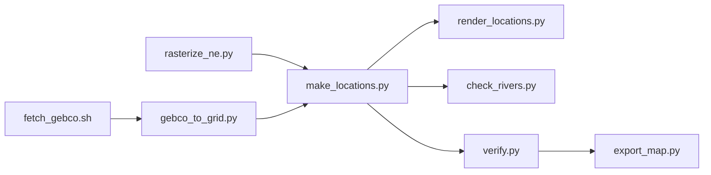

<div align="center">

# WrektBurgerEngine

**Build a grand strategy game from images and plain-text files.**
C# · .NET 8 / 9 · raylib

*Inspired by Paradox Interactive's grand strategy games.*

[Quick start](#quick-start) · [Choose your path](#choose-your-path) · [Docs](#documentation) · [What's new](#whats-new-on-this-branch)

</div>

---

## At a glance

- **Data-driven.** A game is a map (PNG images) plus text files. Export produces a standalone executable, and the `game/` folder beside it stays editable, so players can mod everything.
- **Pick your mechanics.** Warfare, diplomacy, characters, economy, politics, AI and more are *features* you add or remove per project.
- **Two ready-made worlds.** Earth in 1930, and (on this branch) the world of 500 BCE.
- **Built-in editor.** *Burger Studio* is a dockable editor with a live 3D map, inspector and code panels.

> [!NOTE]
> This is a fork of [BurgerKingHotline/BurgerEngine](https://github.com/BurgerKingHotline/BurgerEngine). The `map-500bce` branch adds an ancient-world scenario, a geography layer, a globe view and a rebuilt terrain renderer. Sections below are collapsed; click a heading's arrow to expand it.

---

## Choose your path

| I want to… | Start here |
| --- | --- |
| **Try it out** | [Quick start](#quick-start) |
| **Make a game** | [Making a game](#making-a-game) |
| **Mod an exported game** | [Modding](#modding-an-exported-game) |
| **Explore the 500 BCE world** | [Worlds](#worlds) |
| **Build or rebuild the map data** | [Map pipeline](#map-pipeline) |
| **Hack on the engine** | [Engine development](#engine-development) |
| **Look something up** | [Reference](#reference) |

---

## Quick start

**Needs:** the [.NET 8 SDK or newer](https://dotnet.microsoft.com/download) (.NET 9 works on Arch Linux / CachyOS) and NuGet access on first run.

```bash
# Linux
./BurgerStudio.sh                  # open the editor
./BurgerEngine.sh run SampleGame   # play the sample game
```

```bat
:: Windows
BurgerStudio.bat
```

That's enough to get going. Details for each platform:

<details>
<summary><b>Windows walkthrough</b></summary>

1. Install the .NET SDK.
2. Double-click **`BurgerStudio.bat`**. The first run builds the engine. `BurgerEngine.bat` offers the same functions as a text menu.
3. Choose **1 - Play a project** to run `SampleGame`.
4. Create your own game from Studio's start screen: pick a map, a preset and the features you want, or take a full copy of the sample game.
5. Choose **4 - Export** to get `projects/<YourGame>/export/<Name>/<Name>.exe` plus its `game/` folder. Zip it and share it.

</details>

<details>
<summary><b>Linux walkthrough (Arch / CachyOS)</b></summary>

```bash
sudo pacman -S dotnet-sdk mesa
./burger.sh list                    # list CLI commands
./BurgerStudio.sh                   # editor
./BurgerEngine.sh run SampleGame    # sample game
```

- You need an OpenGL-capable desktop session (X11 or Wayland). Headless startup is not supported.
- The launchers build the projects in Release mode and resolve paths relative to the repository.
- Raylib-cs 7.0.2 supplies the managed binding and Linux native assets; no separate native port is needed.

> [!WARNING]
> Linux **export** is unverified. Playing, the editor and the CLI are the supported paths.

</details>

<details>
<summary><b>Requirements by platform</b></summary>

| Platform | Needs |
| --- | --- |
| All | .NET 8 SDK or newer, NuGet access on first run |
| Windows | Nothing else |
| Linux | OpenGL-capable desktop session, Mesa |
| Map pipeline | Python 3 and bash, plus network access to download source data |

The 500 BCE world is large (default grid 16384 x 8192), so expect higher memory and GPU use than the sample game.

<!-- verify: Python package requirements for tools/map500bce -->

</details>

---

## What's new on this branch

<details>
<summary><b>Summary of changes versus <code>main</code></b></summary>

- **500 BCE scenario** and a cut-map `World500BCE` project, with new `globe_mode` and `lat` map keys.
- **Geography layer** (`Burger.Core/Geography`) with a historical calendar and timeline for BCE dates, plus CLI commands.
- **Globe mode**, a wrapped flat map, a trackball camera and a benchmark harness.
- **Terrain renderer upgrade:** optional normal maps, a dense chunked terrain mesh, a richer map shader and a padded terrain atlas with wide, noisy blending.
- **Normal maps** for the `earth1930` and `isle` bases, plus tools to generate them.
- **Country labels** that are steadier and fade out when too large or mostly off screen.
- **Configurable world grid**, defaulting to 16384 x 8192.
- **Map data pipeline** (`tools/map500bce`) with a reviewed, license-checked source ledger.
- **.NET 9 support**, a changelog and a development log.

<!-- verify: confirm scenario start date and project path (projects/World500BCE) -->

</details>

<details>
<summary><b>Carried over from <code>main</code></b></summary>

- Linux Bash launchers mirroring the Windows `.bat` files.
- Camera stabilization: damped movement, input decoupled from rendering, cursor tracking anchored to the logical camera.
- Log location control: `logs/error.log` by default, `--log-dir <folder>` to redirect.
- A partial UI override example in `examples/ui-partial-override/game/interface`.
- Earth 1930 source assets in `assets_src/earth1930`.

</details>

---

## Worlds

<details>
<summary><b>The 500 BCE world</b> (this branch)</summary>

Built from open data rather than drawn by hand:

- **Terrain and bathymetry:** GEBCO, reduced to the working grid.
- **Coastlines and water:** Natural Earth, rasterized onto the same grid.
- **Rivers:** checked with `check_rivers.py`; river width references include the GRWL database.
- **Locations:** generated by `make_locations.py`, previewed by `render_locations.py`.

The project is a **cut map**, `World500BCE`, with a dated scenario on the engine's historical calendar. Terrain relief is exaggerated for readability (`height_scale` 7) and shaded with a generated normal map and seamless 2048 px terrain textures.

<!-- verify: start date, number of locations / states / countries, launch command -->

<details>
<summary>Regenerating the relief and normal map</summary>

```bash
python tools/earth/exaggerate_height.py <args>   # optional: exaggerate relief
python tools/earth/make_normal.py <args>         # normal map from the heightmap
```

Then add `normalmap = "normal.png"` to the base's `map/default.map`.

<!-- verify: argument syntax for both scripts -->

</details>

</details>

<details>
<summary><b>Earth 1930</b></summary>

`assets/bases/earth1930` is the whole world (Mercator, 78°N to 58°S, 6144 x 3456 px) on 1 January 1930:

- 5,300 land locations named after their largest towns (1930 names such as Danzig, Stalingrad or Batavia)
- 950 sea zones and 158 lakes
- 1,450 states and 74 countries, with flags, capitals and populations
- Straits, rivers, terrain (plains, forest, jungle, hills, mountains, desert, marsh, tundra, glacier) and air regions

Colonies belong to their empires; dominions and the British Raj are subjects of the United Kingdom (with the `diplomacy` feature). `projects/Earth1930` is a playable 1930s-era game on this map.

<details>
<summary>How it is generated</summary>

It is built from public-domain Natural Earth data and free elevation tiles by `tools/earth/make_earth.py`. The 1930 world itself (owners, capitals, colors, flags) lives in `tools/earth/earth1930_data.py`, so another start date is a matter of editing that file and re-running the generator. See `tools/earth/README.txt`.

</details>

</details>

<details>
<summary><b>Other bases</b></summary>

`assets/bases/isle` is a small island map used by the sample game. Both `isle` and `earth1930` ship a `normal.png` on this branch.

</details>

---

## Making a game

<details>
<summary><b>The 60-second model</b></summary>

- A map is built from a **province map**, heightmap, terrain map, tree map, river map and (optionally) a normal map.
- Every province color is a named **location**. Locations group into **states**. States are owned and cored by **countries** (3-letter tags like `GER`).
- Mechanics come from **features** you install per project.
- Content is plain text: countries, units, events, diplomacy, characters, localisation.
- Logic can be extended with **C# scripts**.

</details>

<details>
<summary><b>Burger Studio (the editor)</b></summary>

Studio is built into the engine (Dear ImGui) and laid out like a game-engine editor. Every panel can be dragged, docked, tabbed or closed; *View > Reset layout* restores the default.

| Panel | What it does |
| --- | --- |
| **Viewport** | The live 3D map. Click selects a location and its state; middle-drag / WASD pans; wheel zooms. **Paint state** moves locations between states by dragging. |
| **Inspector** | Properties of the selection: a form for common keys plus the full script. Owners, cores, claims, tax, manpower, names. Drop a PNG to set a flag or portrait. |
| **Content Browser** | **Game** and **Backend** roots, thumbnails, search, **+ Create** for most content types. Rename (F2), duplicate, delete, import by drag-and-drop. |
| **Code** | Tabs for script and C# files with syntax and compile checks, templates and a list of script words. |
| **Console** | *Problems* from **Check (F7)**, the engine *Log*, and *Output* of Play/Export. |
| **Project Settings** | `game.txt`, combat model, game speeds, defines, replaceable formulas, display texts. |

An **Outliner** opens from the View menu. Edits change only the keys you touch, so comments and formatting survive. Nothing is written until you save (Ctrl+S); Play (F5), Check (F7) and Export save first.

</details>

<details>
<summary><b>Features (mechanics)</b></summary>

A project's installed features are listed in `game/features.txt`. The engine only runs systems for installed features, so a blank slate has no armies, wars, characters or money until you add them. Manage them in **Project > Features** or with `burger features`.

<details>
<summary>Military and war</summary>

| Feature | Adds |
| --- | --- |
| `military` | Unit types, division templates, armies, movement, fronts, battles, occupation, recruit menu |
| combat model features | Three built-in combat models plus a commented `combat_custom` template; the active one is `combat_model` in defines |
| `production` | Factories, production lines, equipment stockpile, construction queue |
| `supply_range` / `supply_hubs` | Supply from your land (range) or from capital and railway hubs. Pick one |
| `division_designer` | In-game division template design |
| `navy` | Ships, fleets, naval battles, transports, naval invasions |
| `air` | Air regions, wings, air superiority, close air support, strategic bombing |
| `battle_plans` | Front segments, offensive arrows, fallback lines |
| `lend_lease` | Send volunteers and equipment to countries at war |
| `fog_of_war` | Hidden enemy armies and unseen land |

> [!TIP]
> Run `burger features <Project>` to see the exact feature ids, including the combat model ids.

</details>

<details>
<summary>Politics and society</summary>

| Feature | Adds |
| --- | --- |
| `politics` | Ideologies, ruling party, elections, coalitions, political power and stability |
| `laws` | Law groups with costs and modifiers |
| `cabinet` | Ministers in cabinet posts (needs `characters`) |
| `civil_wars` | Political movements, revolts and civil wars |
| `population` | Pops by culture that grow, assimilate and migrate |
| `religion` | Religions, conversion, religious opinion and unrest |
| `social_classes` | Nobles, clergy, burghers, peasants and serfs with promotion; suits ancient and medieval eras |
| `cores_claims` | Core and claim rules based on accepted cultures |
| `colonization` | Colonists that settle unowned land near your territory |
| `independence` | Independence movements and wars of independence |
| `buildings_classic` / `buildings_modern` | Era-appropriate buildings affecting growth, tax, assimilation and stability |

</details>

<details>
<summary>Diplomacy, characters, economy and AI</summary>

| Feature | Adds |
| --- | --- |
| `diplomacy` | Casus belli, war goals, war score, peace offers, subjects, pacts, opinion, alliances, access, guarantees |
| `characters` | Rulers, heirs, families, births, deaths, succession, traits |
| `character_interactions` | Appoint heir, make general, gifts, marriages, execution |
| `economy` | Tax income, upkeep, manpower; training costs gold and manpower |
| `ai` | Computer-controlled countries (each part only for installed features) |

</details>

<details>
<summary>How adding and removing works</summary>

Adding a feature copies its files into the project, so they become yours. Removing one deletes its unchanged files and moves changed ones to `removed_features/<id>/`. Custom ids (*Add custom*) add no files; check them with `has_feature = my_feature` or `Game.Features.Has("my_feature")`.

The **Ledger** (F9) charts population, income, manpower, divisions, war dead and more over time. C# mods can add metrics with `Game.Statistics.Add(...)`.

</details>

</details>

<details>
<summary><b>Anatomy of a project</b></summary>

```
game/
  game.txt                      name, version, default country
  features.txt                  installed features
  common/defines.txt            rules (combat_model, occupation, diplomacy, characters...)
  common/countries/*.txt        TAG = { name color flag capital ruler ... }
  common/terrain.txt            terrain types (map color, texture, movement, combat)
  common/units/*.txt            unit types and division templates
  common/traits.txt             character traits
  common/casus_belli.txt, subject_types.txt
  common/diplomatic_actions/    data-driven diplomacy
  common/character_interactions/
  common/on_actions/            hooks (game start, monthly pulse, war declared, ...)
  map/default.map               images and settings (normalmap, globe_mode, lat ...)
  map/provinces.png heightmap.png terrain.png trees.png rivers.png normal.png
  map/locations.txt             HEX = location_name
  map/states/*.txt              states: locations, owner, cores, claims
  history/characters/  history/units/  history/diplomacy.txt
  events/*.txt                  country_event / character_event
  localisation/*.txt            key = "text"
  gfx/flags/TAG.png  gfx/terrain/*.png
  scripts/*.cs                  C# mod scripts
backend/                        locked C# compiled into the EXE (not shipped as files)
```

</details>

<details>
<summary><b>Scripting</b></summary>

Two layers, both covered in [`docs/MODDING.md`](docs/MODDING.md):

1. **Text script** for content: triggers, effects, scopes, events and on_actions, with tooltips and a validator. Every trigger, effect and scope is listed in [`docs/SCRIPT_REFERENCE.md`](docs/SCRIPT_REFERENCE.md) (generated by `burger docs`). Problems show in the in-game error log (F2) and Studio's Problems list (F7).
2. **C# scripts** for logic: add triggers, effects, combat models and console commands, or replace the diplomacy, economy, character and movement rules or the AI.

<details>
<summary>Game code vs backend code</summary>

| Folder | Players can change it? | Use it for |
| --- | --- | --- |
| `game/scripts/*.cs` | Yes. Shipped as files, compiled when the game starts | Mod-friendly additions |
| `backend/*.cs` | **No.** Compiled into the EXE on export, files not shipped | Your game's real rules |

Both use the same `GameScript` API and compile at startup during development, so there is no rebuild step. Features place copies of the engine's rules in `backend/` (warfare, combat, vision, diplomacy, characters, economy, AI). Edit them freely; delete one and the engine's built-in version is used again. The engine itself (map loading, rendering, script language) is part of neither.

</details>

</details>

<a id="modding-an-exported-game"></a>

<details>
<summary><b>Modding an exported game</b></summary>

An exported build ships a `game/` folder next to the executable. Players can edit any file in it, including text content and `scripts/*.cs`. Anything you put in `backend/` is compiled into the executable and is *not* moddable, so keep core rules there only if you want them locked.

See [`docs/MODDING.md`](docs/MODDING.md) and the partial override example in `examples/ui-partial-override/`.

</details>

---

## Under the hood

<details>
<summary><b>Geography layer</b></summary>

`src/Burger.Core/Geography/` adds a geographic model alongside the province map.

| File | Role |
| --- | --- |
| `GeoModel.cs` | Core geographic data types |
| `GeoRegistry.cs` | Loads and indexes geographic features |
| `GeoMetrics.cs` | Geographic measurements |
| `GeoValidator.cs` | Validates geography data |
| `HistoricalCalendar.cs` | Calendar handling for BCE-era dates |
| `Timeline.cs` | Ordered historical events and periods |

`src/Burger.Tools/GeographyCommands.cs` exposes this through the CLI (run `burger help` for command names). Map files gain `globe_mode` and `lat` keys.

<!-- verify: what GeoRegistry loads, CLI command names, semantics of globe_mode / lat -->

</details>

<details>
<summary><b>Globe mode and camera</b></summary>

- **Globe mode** renders the world on a sphere; a **wrapped flat map** is the alternative so the map tiles horizontally.
- A **trackball camera** handles globe navigation.
- Camera stabilization from `main` still applies.
- **`Bench.cs`** is a benchmark harness for profiling map rendering.
- View preferences are stored through `UserSettings`.

<!-- verify: how to toggle globe mode in-game and how to run the benchmark -->

</details>

<details>
<summary><b>Rendering</b></summary>

- **Normal maps** are optional: add `normalmap = "normal.png"` to a base's `map/default.map`.
- **Terrain mesh:** dense and chunked.
- **Map shader:** richer than on `main`, with lighting from normals.
- **Terrain atlas:** padded to avoid seams, with a wide, noisy blend between terrain types.
- **Country labels:** follow fitted curves, reuse unchanged names, glide when refit, and fade out when too large or mostly off screen.

</details>

---

## Map pipeline

<details>
<summary><b><code>tools/map500bce</code> overview</b></summary>



<!-- verify: this order is inferred from script names -->

| Script | Purpose |
| --- | --- |
| `fetch_gebco.sh` | Segmented download of GEBCO data |
| `gebco_to_grid.py` | Reduce GEBCO to the working grid |
| `grid.py` | Shared grid dimensions (default 16384 x 8192, configurable) |
| `rasterize_ne.py` | Rasterize Natural Earth data onto the grid |
| `make_locations.py` | Generate locations |
| `render_locations.py` | Render a preview of locations |
| `check_rivers.py` | Sanity-check river data |
| `verify.py` | Verify generated outputs |
| `export_map.py` | Export the finished map into the project |
| `provenance/` | Source ledger, denylist, feature table and saved license terms |

</details>

<details>
<summary><b>Source provenance and licensing</b></summary>

Every external dataset used for the map is tracked and license-checked before use.

- `tools/map500bce/provenance/sources.csv`: the source ledger (source of truth)
- `tools/map500bce/provenance/denylist.txt`: sources that must not be used
- `tools/map500bce/provenance/licenses/`: saved copies of license terms
- `docs/SOURCES/`: saved source pages grouped by subject, indexed in `docs/SOURCES/README.md` and `docs/SOURCES/doc.md`

Recorded outcomes include approvals (Natural Earth coastline, GRWL, Wikidata and several open archaeological and pollen datasets) and rejections (GRIT as non-commercial; HydroRIVERS and the Gazetteer of Ancient Arabia). Some entries are marked unverified or "license not specified".

> [!IMPORTANT]
> Generated map data may carry the licenses of its sources. Check `sources.csv` before redistributing it.

</details>

---

## Engine development

<details>
<summary><b>Building and changing the engine</b></summary>

Open `BurgerEngine.sln` in Visual Studio, Rider or VS Code. Most game logic can be changed from a project's `scripts/` folder without touching the engine (see *C# scripting* in `docs/MODDING.md`). After changing engine code, run **7 - Rebuild** in `BurgerEngine.bat` on Windows, or re-run the relevant `.sh` launcher on Linux.

| Project | Contents |
| --- | --- |
| `src/Burger.Core` | Simulation, scripting, map processing, warfare, diplomacy, characters, saves, geography |
| `src/Burger.Game` | Renderer and user interface (raylib): `MapRenderer`, `Shaders`, `CameraController`, `CountryLabels`, `Bench` |
| `src/Burger.Tools` | CLI: new, validate, run, export, generate-locations, docs, geography commands |

</details>

<details>
<summary><b>Logging and diagnostics</b></summary>

- Diagnostics and `--perf` output go to `logs/error.log` in the repository workspace (git-ignored).
- Use `--log-dir <folder>` with the game executable to choose another location.
- In-game, **F2** shows script problems with file and line.

</details>

<details>
<summary><b>Git-ignored local paths</b></summary>

`logs/`, `projects/World500Test/` (generated test world), `projects/WrektMap/` (local scenario), `.ARCHIVE/` and Python bytecode.

</details>

---

## Reference

<details>
<summary><b>Command line</b></summary>

`burger` (`burger.bat` / `burger.sh`) wraps the `Burger.Tools` CLI.

| Command | Purpose |
| --- | --- |
| `burger help` / `burger list` | Show available commands |
| `burger new <Name> [--preset <id>] [--base <map>]` | Create a project |
| `burger presets` | List feature presets |
| `burger features <Project> [add\|remove <id>]` | Show, add or remove features |
| `burger run <Project>` | Play a project |
| `burger validate <Project>` | Check scripts and data |
| `burger export <Project>` | Produce a standalone build |
| `burger generate-locations` | Generate location data from a province map |
| `burger docs` | Regenerate `docs/SCRIPT_REFERENCE.md` |
| *(geography commands)* | Added in `GeographyCommands.cs`; see `burger help` |

</details>

<details>
<summary><b>In-game controls</b></summary>

| Key | Action |
| --- | --- |
| WASD / arrows / middle-mouse drag | Move the camera |
| Mouse wheel, Q / E | Zoom |
| Space, 1-5 | Pause, game speed |
| Left click | Select a location (or unit counters; Shift adds) |
| Right click | Move/attack with selected divisions, or open a country's diplomacy |
| Tab | Cycle map modes (political, terrain, states, diplomacy, supply, air, locations) |
| F1 / R / F3 / F4 | Military / recruit / characters / wars |
| P / N | Production / navy (with those features) |
| F2 | Error log |
| F5 | Quick save |
| F9 | Ledger |
| F10 | Map editor (move locations between states, set owners and cores) |
| `` ` `` | Developer console (`help`, `tag GER`, `effect add_gold = 100`, `event my.1`, `war FRA`, ...) |

<!-- verify: globe-mode controls and toggle key -->

</details>

<details>
<summary><b>Repository layout</b></summary>

```
WrektBurgerEngine/
  BurgerEngine.bat / .sh      menu: play / new / validate / export / rebuild
  BurgerStudio.bat / .sh      launch the editor
  burger.bat / .sh            command line tool
  BurgerEngine.sln            solution
  Directory.Build.props       shared MSBuild settings
  CHANGELOG.md                release notes
  src/
    Burger.Core/              simulation, scripting, map processing, saves
      Geography/              geography model, registry, validator, calendar, timeline
    Burger.Game/              renderer and user interface
    Burger.Tools/             CLI
  projects/                   SampleGame, Earth1930, World500BCE, your projects
  assets/bases/               base maps: earth1930, isle (each with normal.png)
  assets_src/earth1930/       source inputs for the Earth 1930 generator
  examples/ui-partial-override/
  tools/
    earth/                    Earth 1930 generator, make_normal.py, exaggerate_height.py
    map500bce/                500 BCE map pipeline and provenance ledger
  docs/
    MODDING.md  SCRIPT_REFERENCE.md  DEVLOG-2026-10-14.md  SOURCES/
  logs/                       runtime diagnostics (git-ignored)
```

</details>

---

## Documentation

| Document | Contents |
| --- | --- |
| [`CHANGELOG.md`](CHANGELOG.md) | Release notes |
| [`docs/README.md`](docs/README.md) | Documentation index |
| [`docs/MODDING.md`](docs/MODDING.md) | File formats, scripting, C# mod scripts |
| [`docs/SCRIPT_REFERENCE.md`](docs/SCRIPT_REFERENCE.md) | Generated trigger / effect / scope reference |
| [`docs/DEVLOG-2026-10-14.md`](docs/DEVLOG-2026-10-14.md) | Development log |
| [`docs/SOURCES/README.md`](docs/SOURCES/README.md) | Map source evidence and license notes |
| `tools/earth/README.txt` | Earth 1930 generator |

---

## Credits and license

- **Upstream:** [BurgerKingHotline/BurgerEngine](https://github.com/BurgerKingHotline/BurgerEngine)
- **Fork maintainer:** [TheCascadian](https://github.com/TheCascadian)
- **Map data:** Natural Earth (public domain), GEBCO, and the datasets approved in `tools/map500bce/provenance/sources.csv`, each with its own license and attribution terms
- **Libraries:** [raylib](https://www.raylib.com/) via Raylib-cs, and Dear ImGui

License: *(add or confirm; none was visible on the repository page).*

<sub>Inspired by Paradox Interactive's grand strategy games. Not affiliated with or endorsed by Paradox Interactive.</sub>
