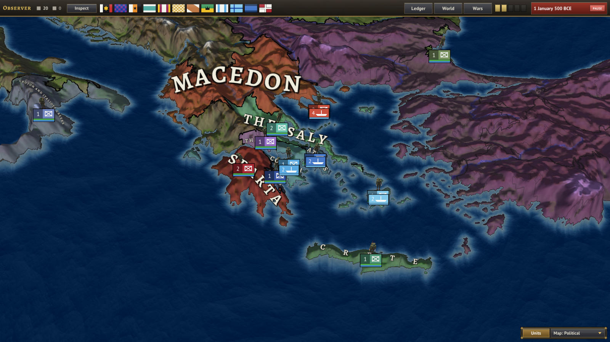

# The authored countries of the 500 BCE start

This file covers the authored countries (ACH, MAC, CAR, NUB, SAB, OLM, CHV, IND, ZHO and the 11 Greek city-states that replaced GRK) listed in `projects/World500BCE/game/common/countries/countries.txt`. Dynamic and generated countries (rebels, released nations, civil-war splits) are not covered.

Tags, names and colors are placeholders, as the countries file says: one country stands for each large power or people.

## How to read this file

Every statement carries one of three labels. Do not mix them up.

| Label | Meaning |
|---|---|
| **GAME** | Read from the game files in this repository. Exact. |
| **HIST** | Historical background from general scholarship, NOT stored in any game file. Dates are approximate (BCE) and several are disputed. Written from memory, not looked up while writing. Check before quoting. |
| **OPEN** | Unknown, disputed, or a mismatch in the game data that needs a decision. |

The game files hold no named rulers, no named factions, no rituals and no war doctrines. Everything under those headings is HIST and is background for future authoring (events, characters, uniforms, AI profiles), not a description of current behavior.

## At a glance (GAME)

| Tag | Country | Culture | Religion | Capital location | States | Population | Manpower (state sum) | Start armies | Gear models |
|---|---|---|---|---|---|---|---|---|---|
| ACH | Achaemenid Empire | persian | mazdayasna | land_07110 (Mesopotamia) | 103 | 25,269,541 | 1,265 | 24 infantry divisions | Own set (`gear_*_ach.glb`) |
| ATH, SPA, COR, ARG, THB, THS, CRT, NAX, CRO, SYR, PNT | Greek city-states (split from the old GRK) | greek, western_greek, pontic_greek | hellenic_religion | see the Greek section | 10 (before the split) | 1,071,654 | 54 | 12 divisions in all | Generic soldier |
| MAC | Macedon | greek | hellenic_religion | land_05247 (Macedon and Epirus) | 1 | 179,496 | 9 | 2 | Generic soldier |
| CAR | Carthage | punic | canaanite_religion | land_09105 (Carthage and Tunisia) | 6 | 1,039,904 | 52 | 2 | Generic soldier |
| NUB | Kush | kushite | kushite_religion | land_08279 (Nubia and Napata) | 3 | 633,812 | 32 | 2 | Generic soldier |
| SAB | South Arabia | south_arabian | south_arabian_polytheism | land_09216 (South Arabia) | 6 | 1,583,519 | 80 | 2 | Generic soldier |
| OLM | Olmec | maya | mesoamerican_religion | land_15261 (Olmec Gulf Coast) | 9 | 2,217,462 | 112 | 3 | Generic soldier |
| CHV | Chavin | chavin | andean_religion | land_11805 (Chavin Peru) | 5 | 1,361,269 | 68 | 2 | Generic soldier |
| IND | Magadha and Ganges | indo_aryan | vedic_brahmanism | land_03808 (Magadha) | 66 | 17,570,032 | 879 | 22 | Generic soldier |
| ZHO | Zhou | huaxia | zhou_ancestor_cult | land_01707 (Zhou states, Yellow River) | 146 | 36,723,283 | 1,842 | 24 | Generic soldier |

Shared start values: every country begins with 100 gold and 10,000 manpower. The default (player) country is ACH. The scenario uses these features: population, religion, social_classes, cores_claims, military, diplomacy, characters, economy, politics, ai, combat_imperator, laws, civil_wars, independence, ai_profiles, navy.

Population and manpower figures were computed from `map/states/00_states.txt` (owner and manpower) and `history/pops/00_pops.txt` (pops of owned states).

### Starting relations (GAME, `history/diplomacy.txt`)

- ACH is overlord of SAB (tributary: pays 25% of income, does not join ACH wars, base liberty desire 10).
- ACH is overlord of NUB (client state: pays 10% of income, joins ACH wars, base liberty desire 0).
- SPA and COR are allied. MAC and THS are allied. (GRK no longer exists.)
- CHV and OLM are allied.

### The four ideologies, read as 500 BCE factions (GAME + interpretation)

The politics file says: democratic = citizen assemblies and republics; neutrality = kings and priests; fascist = warrior-nationalist factions; communist = commoner and slave levelers. Every country has a popularity for all four, so each always has a "shut-out" movement that can grow into unrest, coups or civil war. The ideology modifiers are GAME: democratic gives +5 stability target and opinion; neutrality gives +5 stability target; fascist and communist give +3 political power gain and extra manpower (+15% and +10%) and are marked extremist. The faction names below are HIST labels for what each bloc plausibly stands for.

Laws available (GAME): conscription (volunteer_only, limited, extensive, service_by_requirement), economy, press, political_parties (multi_party, restricted_parties, single_party) and culture policy (equal_rights, tolerance, discrimination, forced_assimilation). Every country except ATH, ARG, NAX and CAR starts with `restricted_parties`, which bans the communist and fascist parties from seats and government.

### Classes (GAME, `common/pop_types`)

Farmers, herders, foragers, artisans, nobles, clergy, slaves. Starting class mix per country is listed in each section.

### Casus belli available to all (GAME)

Reclaim cores, cultural unification, press claims, war of independence, liberation, and others in `common/casus_belli.txt`. No country has its own.

### Military data shared by all (GAME)

Unit types are infantry, artillery and cavalry; division templates are infantry_division (6 infantry), artillery_division (5 infantry, 1 artillery) and cavalry_division (4 cavalry). Every starting army is infantry divisions only. Starting fleets for ACH, MAC, CAR, SAB, OLM, CHV, IND and ZHO use modern ship classes (destroyer, light_cruiser, battleship, transport); NUB has no fleet. **OPEN**: these ship classes and the "artillery" unit are anachronistic placeholders for 500 BCE.

---

## ACH: Achaemenid Empire

### In the game files (GAME)

- Color 120/60/150. Capital land_07110. Culture persian, religion mazdayasna.
- 103 states, 25.3 million people. Culture mix: Persian 4.78M, Babylonian 3.89M, Indo-Aryan 3.82M, Anatolian 3.27M (more cultures further down). Religion mix: mazdayasna 7.8M, Mesopotamian polytheism 3.9M, Vedic Brahmanism 3.8M, others.
- Classes: farmers 18.8M, slaves 3.0M, artisans 2.0M, nobles 0.77M, clergy 0.75M.
- Politics: ruling party neutrality. Popularity neutrality 45, fascist 30, democratic 15, communist 10. Law: restricted_parties.
- AI profile "persia" (parent: expansionist). Description: "A vast empire that wants Greece, Egypt and the steppe." Rivals ATH 2, SPA 1, MAC 1. Wants ATH 2.5, NAX 2, MAC 2, SPA 1.5, THB 1, IND 1.5, NUB 1.5. Timing: NAX -500, ATH -499, MAC -498, SPA -497.
- Army: "1st Army", 24 infantry divisions at the capital. Fleet "Home Fleet" at land_09609.
- Overlord of SAB (tributary) and NUB (client state).
- The only country with its own soldier set. Uniform: saffron tunic (0.85/0.60/0.13), brown leather, soft cloth cap, soft boots, no firearm. Pieces: tunic, boots, headgear, wicker shield (`gear_shield_ach`), spear (`gear_spear_ach`). Soldiers carry the spear upright with the shield on a raised left forearm and have two spear attacks (thrust and deep lunge), picked at random in battle.

### Rulers (HIST)

Darius I "the Great" (r. 522 to 486), king of kings, of the Achaemenid line through Hystaspes. Queen Atossa (daughter of Cyrus, wife of Darius), a power at court; other wives include Artystone. Crown prince Xerxes is a boy of about 14 in 500 (born c. 519 to 518). Key names: Artaphernes, satrap of Sardis and the king's brother; Hystaspes, the king's father, governor of Parthia; Megabates and Otanes in the Ionian theater; Mardonius, Darius's son-in-law, rises later. Exiled tyrant Hippias of Athens is at the Persian court.

### Internal politics and factions (HIST)

- **The king and the seven houses.** Darius took the throne in 522 with six noble co-conspirators (Otanes, Intaphrenes, Gobryas, Hydarnes, Megabyzus, Aspathines). Their houses keep privileges, including marriage ties to the king and the right of audience. This is the "neutrality" bloc: king, court and great nobility.
- **Satraps vs. the center.** About twenty satrapies pay fixed tribute (Darius's reform). Satraps are powerful provincial governors checked by royal secretaries and "the king's eyes and ears" inspectors. A satrap who grows too independent is the standing fear (the "fascist" warrior-nobility bloc: Persian and Median cavalry lords).
- **Priests.** The Magi are a priestly class (Median in origin), influential but still distrusted after the rule of the Magus Gaumata in 522.
- **Subject peoples.** Ionian Greek cities under tyrants friendly to Persia, Babylon (rebelled twice in 522 and 521), Egypt, Lydia, Judea, Indus provinces. The Ionian Revolt breaks out in 499. Commoner and slave unrest is the "communist" bloc.
- **Administration.** Standard weights, the gold daric and silver siglos, the Royal Road from Sardis to Susa, Aramaic as the chancery language, Old Persian cuneiform for monuments (the Behistun inscription, c. 520 to 518).

### Culture and traditions (HIST)

Persian boys are famously taught "to ride, to shoot the bow and to speak the truth" (Herodotus). Royal hunts in walled parks (paradeisoi, "paradises"), banquets with the king reclining, gift giving as political language, proskynesis (obeisance) before the king. Building at Susa and Persepolis (begun c. 518). Trousers (anaxyrides), long coat (kandys) and the felt cap are the Persian look; the Medes wear similar dress.

### Religion and ritual (HIST)

Worship of Ahuramazda, named in Darius's inscriptions (whether this is the same as later Zoroastrianism is debated). Rites are done outdoors on high places, with fire and sacrifice led by Magi; the Magi chant, hold the bundle of barsom twigs and take the sacrificial animal. Exposure of the dead to birds (practiced at least by the Magi) before burial. The king is buried in rock-cut tombs (Naqsh-e Rostam, Darius's tomb). Persian rule tolerates and funds local temples (Egypt, Babylon, Jerusalem).

### Doctrine of war (HIST)

- A multiethnic army raised by satrapy: a Persian and Median core, vassal contingents each fighting in its own gear.
- **Archers behind a wall of shields.** The sparabara ("shield bearers") plant big wicker shields (the spara) in the ground and shoot over them. This is the signature battlefield formation. The game's shield and spear pieces model it.
- **Cavalry on the wings** (Persians, Medes, Sacae, Bactrians) to outflank and harass.
- **The Immortals**, a 10,000-man guard kept at constant strength. Infantry with the bow and a short spear.
- **Navy** is Phoenician, Egyptian, Cypriot and Ionian Greek, built and crewed by subjects.
- Strategy: logistics through the satrapies, bridging and canals, diplomacy and gold to split enemies.

### Equipment (HIST, and GAME where noted)

Common Persian infantry: soft felt cap (tiara), tunic with sleeves, trousers, soft shoes, wicker shield, short spear, bow and quiver, akinakes (short dagger). Elite: scale or quilted body armor under the tunic, more ornament. Median and Persian cavalry: javelins, bow, spear. Game version (GAME): saffron tunic, leather, soft cap, soft boots, spear and wicker-style shield.

### OPEN

- The country name "Achaemenid Empire" is a placeholder; the game could instead use "Persia" or "Parsa".
- Fleet and artillery data are anachronistic (see the shared note above).

---

## The Greek city-states (ATH, SPA, COR, ARG, THB, THS, CRT, NAX, CRO, SYR, PNT)

The old single country GRK ("Greek Poleis") no longer exists. Its 10 states were split into 11 countries, one per major polis or league. Political inner workings (parties, factions, events) are deferred: each country has only a starting ruling party, popularity and one law.

### Shared facts (GAME)

- All 11 start with 100 gold, 10,000 manpower, religion hellenic_religion, a "1st Army" at their capital, and a name and color of their own. Armies: SPA 2 infantry divisions; THS 1 infantry plus 1 cavalry; every other one 1 infantry.
- Fleets (placeholder, 2 transports each): ATH, COR, NAX, SYR. The others have none. The old modern warship classes were NOT carried over.
- Relations: SPA allied with COR (the Peloponnesian League core, HIST). MAC allied with THS (a design choice, OPEN). The old GRK to MAC alliance was removed.
- AI profiles: "athens" (defensive; rivals ACH 2.5, THB 1, CAR 0.5; friend NAX), "sparta" (status_quo; rivals ARG 2, ACH 1, ATH 0.5; friend COR 2), "greek_cities" (defensive; COR ARG THB THS CRT NAX CRO PNT; rival ACH 1), "syracuse" (status_quo; rival CAR 2). ACH now wants ATH 2.5, NAX 2, MAC 2, SPA 1.5, THB 1 (awakening NAX -500, ATH -499, MAC -498, SPA -497). MAC now wants THS 2 (from -490). CAR rivals SYR 1.5 and CRO 0.5.
- Population numbers are the old GRK numbers re-divided, and are design estimates, not census data. Sparta's mix was changed on purpose: 45% slaves (the helots), 36% farmers, 12% artisans (the perioikoi, HIST), 5% nobles.
- Provinces are coarse. Athens and Boeotia in particular are small provinces, and the Boeotian plain may fall partly inside the Phocis province. Euboea (Chalcis, Eretria), Aegina and Delphi have no province of their own. The Aetolia and Acarnania state is now unowned (tribal).

| Tag | Country | Capital | States | Population | Manpower | Culture | Ruling party (popularity) | Parties law | Color |
|---|---|---|---|---|---|---|---|---|---|
| ATH | Athens | land_01113 | Attica | 98,105 | 4 | greek | democratic (dem 40, neu 22, fas 20, com 18) | multi_party | 70/120/200 |
| SPA | Sparta | land_05800 | Laconia and Messenia | 116,500 | 5 | greek | neutrality (neu 44, fas 40, com 10, dem 6) | restricted | 170/40/50 |
| COR | Corinth | land_05412 | Corinthia, Ionian Islands | 56,998 | 4 | greek | neutrality (neu 44, dem 26, com 16, fas 14) | restricted | 90/170/225 |
| ARG | Argos | land_08799 | Argolis | 45,986 | 3 | greek | democratic (dem 36, neu 28, fas 22, com 14) | multi_party | 55/85/160 |
| THB | Thebes | land_07184 | Boeotia and Phocis | 102,426 | 5 | greek | neutrality (neu 46, fas 28, dem 14, com 12) | restricted | 150/110/200 |
| THS | Thessaly | land_09076 | Thessaly | 102,426 | 5 | greek | neutrality (neu 50, fas 28, com 14, dem 8) | restricted | 100/190/170 |
| CRT | Crete | land_15921 | Crete | 83,169 | 4 | greek | neutrality (neu 42, fas 32, dem 14, com 12) | restricted | 80/150/120 |
| NAX | Naxos and the Cyclades | land_15916 | Lemnos and the North Aegean, Cyclades | 30,767 | 2 | greek | democratic (dem 38, neu 32, com 18, fas 12) | multi_party | 130/200/235 |
| CRO | Croton and Italiote Greeks | land_08888 | Magna Graecia | 203,071 | 10 | western_greek | neutrality (neu 44, dem 24, fas 18, com 14) | restricted | 110/130/190 |
| SYR | Syracuse and Eastern Sicily | land_01952 | Eastern Sicily | 70,769 | 4 | western_greek | neutrality (neu 46, fas 24, com 18, dem 12) | restricted | 190/160/225 |
| PNT | Pontic Greek Cities | land_07007 | Black Sea Greek coast | 17,591 | 1 | pontic_greek | neutrality (neu 44, dem 26, com 16, fas 14) | restricted | 120/145/95 |

All popularity values are placeholders to be revisited when the political workings are authored. Class mix follows the old GRK ratios (about 40% farmers, 22% artisans, 5% nobles, 3% clergy, 30% slaves) except Sparta.

### Common to all Greek cities (HIST)

- **Culture and religion.** One language in many dialects (Attic-Ionic, Doric, Aeolic, Northwest Greek). Homer and Hesiod as shared texts, Panhellenic games (Olympic every four years, Pythian, Isthmian, Nemean), the Delphic oracle of Apollo, the twelve Olympian gods with local patrons, civic animal sacrifice followed by a shared meal, libations, omen reading, hero cults, the Eleusinian and other mysteries. Priesthoods are civic offices. Citizenship is by birth. The symposium, the gymnasium and the agora are the social centers.
- **Doctrine of war.** The citizen-hoplite phalanx: spearmen in a line 8 or more ranks deep, overlapping shields, pushing until one side breaks; one decisive battle on a flat plain in the campaign season; truces for festivals. Light troops (psiloi) and cavalry are minor. Sieges are rare and slow. At sea: penteconters and the new triremes.
- **Equipment.** Bronze helmet (Corinthian, Chalcidian or Attic), bronze or linen cuirass, greaves, round shield (aspis, about 90 cm), thrusting spear (doru, about 2.4 m) with a butt-spike, short iron sword (xiphos) or curved kopis. In the game all eleven currently wear the generic soldier; no Greek gear pieces exist yet.

---

### ATH: Athens

**Rulers (HIST).** No king. In 500 the state is a few years into the reforms of **Cleisthenes** (508 to 507): ten tribes made of local districts (demes), a Council of 500 chosen by lot, the Assembly (ekklesia), and nine yearly archons with ten generals (strategoi). The tyrant Hippias was driven out in 510 and now lives at the Persian court at Sardis. Rising names: Miltiades (Chersonese), Themistocles (born c. 524), Aristides, Xanthippus. Athens sent ships to help Ionia in 498 (after the game start).

**Internal politics and factions (HIST).** The old landed families (Eupatridai) and the supporters of Isagoras (the rival of Cleisthenes, backed by Sparta) against the new demos; the Alcmaeonid clan, which led the reform; the Peisistratid party that wants Hippias back; the poor (thetes) who row the fleet; metics and slaves with no vote. In the game these map onto democratic (demos), neutrality (old families), fascist (hoplite and returning-tyrant militarists) and communist (the landless and debtors). Deferred.

**Culture and traditions (HIST).** Panathenaic festival and games; Dionysia (tragedy since c. 534); black-figure and new red-figure pottery; the silver of Laurion; the owl coinage; Athena as patron; the oath of the ephebes (later).

**Religion and ritual (HIST).** Athena Polias on the Acropolis; the Eleusinian Mysteries; Dionysus; Apollo Patroos; the Anthesteria; the Thesmophoria (women only); ostracism is not yet used (first use 487).

**Doctrine of war (HIST).** Hoplites by tribe under a polemarch and generals; strong at home, weak at sea until the Laurion fleet of 483. In the game: defensive profile, the Great King is the main enemy.

**Equipment.** See the shared list. Cavalry are rich citizens (hippeis).

### SPA: Sparta

**Rulers (HIST).** Two hereditary kings: **Cleomenes I** (Agiad, r. c. 519 to 490) and **Demaratos** (Eurypontid, r. c. 515 to 491). Five ephors elected yearly check the kings; the council of elders (gerousia, 28 men over 60 plus the kings); the assembly of Spartiates (apella).

**Internal politics and factions (HIST).** The two royal houses quarrel (Cleomenes and Demaratos famously fall out); the ephors against the kings; about 8,000 full citizens (Spartiates) ruling several times more perioikoi (free non-citizens) and a mass of **helots**, the enslaved farmers of Laconia and Messenia who outnumber them and may revolt. In the game: a large fascist bloc (40%, warrior nationalists) beside a ruling king-and-elders bloc, and 45% slaves.

**Culture and traditions (HIST).** The agoge (state upbringing from age 7), common messes (syssitia), the krypteia (secret police against helots), iron money, limited wealth display, short speech (laconic), choral festivals (Gymnopaidiai, Hyacinthia, Carneia), strong women's role in property.

**Religion and ritual (HIST).** Apollo (Carneia festival, during which Sparta will not march), the Dioscuri (kings carry their images), Artemis Orthia (the endurance rite), Zeus and Athena; kings serve as priests and keep Delphic oracles; the king's funeral is a state-wide rite.

**Doctrine of war (HIST).** The best infantry in Greece: full-time Spartiate hoplites in a red cloak, long hair, advancing in step to the pipes; the 300 hippeis guard; perioikoi fight alongside; helots as servants. Leader of the **Peloponnesian League**: allies send contingents and follow Sparta in war. Reluctant to fight far from home (fear of helot revolt).

**Equipment.** Red cloak (phoinikis), bronze helmet and shield with the lambda (the lambda comes later), spear and short sword; no body armor in many accounts.

### COR: Corinth

**Rulers (HIST).** An oligarchy after the tyranny of the Cypselids ended in 583 (and an earlier clan, the Bacchiadai, before). Annual magistrates and a council of the rich. **Periander** is dead (c. 585). Corinth leads in the Peloponnesian League with Sparta and acted in 506 to stop Sparta from restoring Hippias in Athens (HIST).

**Internal politics and factions (HIST).** Old aristocrats against merchants and craftsmen (the banausoi); a moderate oligarchy with no tyrant; trade interests against war.

**Culture and traditions (HIST).** Wealth from the isthmus and its two harbors (Lechaion and Kenchreai), the diolkos (portage road), pottery (Corinthian ware, in decline against Attic), bronze work, the Isthmian Games, colonies at Corcyra, Syracuse, Ambracia and Leucas. Famous for temples (Apollo) and for sacred prostitutes of Aphrodite (reported, disputed).

**Religion and ritual (HIST).** Aphrodite on Acrocorinth, Poseidon (Isthmian Games), Apollo, Helios.

**Doctrine of war (HIST).** Good hoplites and the best naval builders of the old world (the trireme was reportedly first built here, c. 700). In the game its state also holds the Ionian Islands (colony sphere).

**Equipment.** The "Corinthian" helmet is named for the city.

### ARG: Argos

**Rulers (HIST).** The old kingship has faded into a magistrate-led state; the king title survives as a religious office. In 494 Argos is crushed by Cleomenes at Sepeia (after the game start), losing most of its citizens.

**Internal politics and factions (HIST).** A citizen assembly with a powerful aristocracy; the deep enmity with Sparta over the border plain (Thyreatis); strong ties with Persia later.

**Culture and traditions (HIST).** The Heraion (temple of Hera) and its festival, Argive shields (the round shield is said to be an Argive invention), bronze work, claims of descent from Heracles and Perseus.

**Religion and ritual (HIST).** Hera Argeia (festival with a procession from the city to the Heraion), Apollo Lykeios, Zeus Larissaios.

**Doctrine of war (HIST).** Hoplites; a thousand-man picked corps (the "thousand" of Argos, later). Spartan rival; at risk until the loss at Sepeia.

### THB: Thebes (Boeotia and Phocis)

**Rulers (HIST).** Thebes leads the **Boeotian League** (federation of cities with 11 elected boeotarchs) under an oligarchy; rival of Athens and of Plataea (which leaned to Athens in 519 and 509). Phocis (Delphi's neighbors) is a separate federation, in the same province in this game.

**Internal politics and factions (HIST).** The oligarchs against the smaller Boeotian towns that resist Theban leadership; a pro-Persian party grows later (Medism).

**Culture and traditions (HIST).** Poets (Pindar, born c. 518; Corinna), the sacred precinct of the Ismenion, the festival of Daphnephoria; deep ties with Delphi in the Phocis part.

**Religion and ritual (HIST).** Dionysus and Heracles (born in Thebes by myth), Apollo Ismenios, Demeter. Delphi is in the neighboring region: the oracle and the Pythian Games.

**Doctrine of war (HIST).** Strong heavy infantry in deep formations (25 ranks later) and an elite pairing, the Sacred Band (founded 378, so NOT at 500); good cavalry on the Boeotian plain.

### THS: Thessaly

**Rulers (HIST).** A confederation of cities (Larissa, Pharsalus, Pherae, Crannon) with a chosen overall leader (tagos). The great clans, such as the Aleuadae of Larissa, hold power and later side with Persia.

**Internal politics and factions (HIST).** Wealthy horse-breeding aristocrats against a dependent peasantry (the penestai, serfs); the clans against each other; the Thessalian League against Phocis.

**Culture and traditions (HIST).** Horses and cavalry, large estates, the Thessalian witches of legend, Mount Olympus and Mount Pelion nearby. The Amphictyonic Council of Delphi counts Thessaly as its first member.

**Religion and ritual (HIST).** Zeus (Olympus), Poseidon Petraios, Athena Itonia, the centaur myths.

**Doctrine of war (HIST).** The best cavalry in Greece; weak infantry; the cavalry are used as a shock force and the league can field several thousand horse. In the game: 1 infantry and 1 cavalry division.

### CRT: Crete

**Rulers (HIST).** Many independent cities (Knossos, Gortyn, Lyttos, Kydonia, Dreros) run by aristocrats called kosmoi (ten per city). The Gortyn law code (inscribed c. 450) shows later rules.

**Internal politics and factions (HIST).** Competition between cities; aristocratic common meals (andreia); serfs (klarotai) and slaves of Cretan estates.

**Culture and traditions (HIST).** Ancestors of the Minoans; Dorian customs of age-class training, mercenary service abroad, archery and the Cretan cult of the Dictaean cave.

**Religion and ritual (HIST).** Zeus born in the Dictaean or Idaean cave, Rhea, Britomartis, Apollo Delphinios, Minoan survivals.

**Doctrine of war (HIST).** Famous archers and mercenaries; pirate raids by sea; infantry less central than in the mainland.

### NAX: Naxos and the Cyclades (with Lemnos and the north Aegean)

**Rulers (HIST).** Naxos is the richest and strongest island; its tyrant **Lygdamis** (c. 540 to 524) was overthrown, and in 500 an oligarchy or a moderate regime rules. In 499 the Naxians fight off a Persian-backed siege led by Aristagoras of Miletus and Artaphernes (after the game start). The other islands (Paros, Andros, Delos, Keos) are small and hold local rule.

**Internal politics and factions (HIST).** Aristocrats and the demos fought on Naxos before the siege; exiles ask the Persians for help (which prompts the Ionian Revolt). The game's democratic ruling party reflects Naxos's popular government.

**Culture and traditions (HIST).** Marble quarries (Naxos, Paros), huge early statues (the Naxian kouros and the Lions of Delos), wine and Dionysus cult, the sanctuary of Apollo on Delos, shared by the Ionians. Lemnos (north Aegean) was taken by Persia around 510 (a Persian general) and then by Miltiades of Athens (after 500). The state holds it here as a placeholder.

**Religion and ritual (HIST).** Dionysus (Naxos), Apollo and Artemis (Delos), the Delian festival.

**Doctrine of war (HIST).** Naxos could field 8,000 hoplites and a fleet of ships (Herodotus 5.30, a number often doubted); sea power and fortified harbors.

### CRO: Croton and Italiote Greeks (Magna Graecia)

**Rulers (HIST).** Croton is the leader of the Achaean cities of southern Italy; a council of one thousand drawn from the old aristocracy governed Croton, reportedly shaped by the Pythagorean brotherhood. In 510 Croton destroyed neighboring **Sybaris** (richest city in Italy). Others: Tarentum (Spartan colony), Locri, Rhegium, Metapontum, Elea, Cumae (north).

**Internal politics and factions (HIST).** Pythagoreans (aristocrats, philosophers, an intellectual and political club) against democrats; Croton against rivals; the fall of Sybaris leaves a power vacuum and refugees.

**Culture and traditions (HIST).** Pythagoras (the school at Croton, c. 530 to 500), Milo the wrestler (many Olympic wins), doctors of Croton, athletes, the cult of Hera Lacinia, the first western coinage (incuse silver).

**Religion and ritual (HIST).** Hera Lacinia (Cape Lacinium), Apollo, Orphic and Pythagorean beliefs (reincarnation, vegetarian customs, secret teachings).

**Doctrine of war (HIST).** Hoplite armies of citizens; large numbers claimed in the Sybaris war (100,000 men, a number which is likely exaggerated); cavalry on the plains; wary of Etruscans, Lucanians and Carthaginians. Tarentum and Locri are inside this one country in the game.

### SYR: Syracuse and Eastern Sicily

**Rulers (HIST).** Syracuse is ruled by the landed oligarchy of the **Gamoroi**, until Gelon (tyrant of Gela, then of Syracuse in 485). In 500 Hippocrates of Gela (r. c. 498 to 491) is only starting to rise. The east coast cities include Catana, Naxos and Leontini, Megara Hyblaea.

**Internal politics and factions (HIST).** Gamoroi against the native serfs (the Killyrioi) and the common people (the demos); Greek cities against each other and against native Sicels and Carthage in the west.

**Culture and traditions (HIST).** Grain wealth, the Fountain of Arethusa, the earliest Greek theater in Sicily, poets (Epicharmus), fine coinage later, great temples (the Temple of Apollo).

**Religion and ritual (HIST).** Apollo Archegetes, Artemis, Demeter and Persephone (the Sicilian cult of Kore), Zeus Olympios.

**Doctrine of war (HIST).** Strong cavalry (grain and horses) and hoplites; later the greatest fleets in the west. Rival of Carthage (Himera, 480).

### PNT: Pontic Greek Cities (Black Sea coast)

**Rulers (HIST).** Small colonies on the western Black Sea coast (Apollonia Pontica, Mesembria, Odessos, Istros, later Tomis), most founded from Miletus. Each is a polis with its own magistrates. After Darius's Scythian campaign (c. 513) the Thracian coast is under Persian control, and the colonies are under Persian rule.

**Internal politics and factions (HIST).** Colonists against local Thracian and Scythian neighbors who trade and raid; the pull of Miletus (itself soon in revolt).

**Culture and traditions (HIST).** Grain, fish, slaves and hides exported to Greece, mixed Greek and Thracian settlements, Ionic dialect.

**Religion and ritual (HIST).** Apollo (healer, of Apollonia), Achilles Pontarches, Zeus, local Thracian gods.

**Doctrine of war (HIST).** Small citizen militias behind city walls; mercenary and allied native help; dependence on a sea link.

### Open points for the Greek split

- **OPEN**: the ATH to NAX friendship, SPA to COR alliance and the MAC to THS alliance are the starting values; only SPA and COR is firmly historical.
- **OPEN**: no separate country for Euboea (Chalcis, Eretria), Aegina, Plataea, Elis, Megara, Phocis or Aetolia. Add by splitting provinces when the map gets finer locations.
- **OPEN**: Magna Graecia (Croton, Tarentum, Locri, Rhegium) is a single country; split it if one country per city is wanted.
- **OPEN**: Greek gear pieces (helmet, cuirass, shield, spear) are not authored; all 11 wear the generic soldier.
- **Date notes**: Sepeia (494), the Ionian Revolt (499) and the Naxos siege (499) happen right after the 500 start; facts marked "after the game start" are not true at day one.

---

## MAC: Macedon

### In the game files (GAME)

- Color 200/80/60. Capital land_05247 ("Macedon and Epirus"). Culture greek, religion hellenic_religion.
- **1 state**, 179,496 people, all Greek culture and Hellenic religion. Classes: farmers 161,549, nobles 7,179, artisans 7,179, clergy 3,589. No slaves.
- Politics: ruling party neutrality. Popularity neutrality 42, **fascist 38**, democratic 12, communist 8. Law: restricted_parties.
- AI profile "macedon" (parent: aggressive). "A rising kingdom with a warrior nobility." Rival ACH 1. Wants THS 2, awakening in -490.
- Army: 2 infantry divisions. Fleet: 2 destroyers, 1 light cruiser, 1 transport (anachronistic).
- Allied with THS (design choice). The AI profile of ACH lists MAC as a target (want 2, from -498).

### Rulers (HIST)

Amyntas I (r. c. 547 to 498) is king and dies about 498. His son **Alexander I "Philhellene"** (r. c. 498 to 454) follows. The dynasty is the Argeads, who claim descent from Argos and Heracles, with the old capital at Aegae (Vergina). Amyntas gave "earth and water" to Persia around 512 (after Megabazus's expedition); Alexander I keeps Macedon a Persian vassal and later helps and spies on both sides in the Greek wars.

### Internal politics and factions (HIST)

- **King and nobles.** The kingship is hereditary within the royal house, but the king depends on a warrior nobility, the Companions (hetairoi), who hunt and feast with him. This is the "neutrality" bloc and, in game terms, a very strong "fascist" warrior bloc (38%).
- **Upper Macedonian princes** (Lyncestis, Elimeia, Orestis) are semi-independent and a recurring source of challenge.
- **Greek cities on the coast** and Illyrian, Thracian and Paeonian neighbors press the borders.
- Succession by force or intrigue is common (HIST). There is no citizen assembly in the Athenian sense; the army-in-assembly acclaims kings.

### Culture and traditions (HIST)

Court Greek and Macedonian dialect; the Argead claim to Greekness, backed by the Olympic Games (Alexander I was admitted to compete). Hunting, heavy drinking at banquets, horse breeding. A young Macedonian noble must kill a wild boar without a net before he may recline at the banquet (a known custom, attested slightly later). Royal burial in tumulus tombs.

### Religion and ritual (HIST)

Greek gods, especially Zeus, Heracles (the royal ancestor) and Dionysus (with ecstatic rites for women); older mountain cults; Muses at Dion. The king acts as chief priest, leading sacrifices for the army.

### Doctrine of war (HIST)

At 500 BCE Macedon has no famous phalanx (the sarissa and the Macedonian phalanx come with Philip II, 359 and later). Expect: noble heavy cavalry (the Companions) as the king's striking force, light infantry from the peasantry, hoplites only by imitation of the south, plus defense in rugged country. Raids against Illyrians and Thracians; as a Persian vassal, contingents may serve in the Great King's armies.

### Equipment (HIST)

Cavalry: helmet, cloak (chlamys), the broad-brimmed hat (kausia), spear and sword. Infantry: peasant levy with javelins, spears, wicker or leather shields; the best-off have bronze helmets and cuirasses.

### OPEN

- In 500 BCE Macedon is a Persian vassal (HIST), but the game does NOT list it as a subject of ACH; it is allied with THS.
- Culture is "greek", the same as the Greek city-states; there is no separate Macedonian culture in `00_cultures.txt`.

---

## CAR: Carthage

### In the game files (GAME)

- Color 150/40/90. Capital land_09105 ("Carthage and Tunisia"). Culture punic, religion canaanite_religion.
- 6 states, 1.04M people, all Punic and Canaanite. Classes: farmers 442k, slaves 298k, artisans 218k, nobles 50k, clergy 31k.
- Politics: ruling party **democratic**. Popularity democratic 36, neutrality 30, communist 20, fascist 14. Law: **multi_party**.
- AI profile "carthage" (parent: imperial). "A trading power of ships." Rivals SYR 1.5, CRO 0.5. Imperial archetype favors colonies and navy (colonial 1.6, navy 1.5).
- Army: 2 infantry divisions. Fleet of 4 destroyers, 1 light cruiser, 1 battleship, 2 transports (anachronistic).
- Generic soldier.

### Rulers (HIST)

Carthage is a merchant republic. Around 500 it is led by the **Magonid** family: Mago I (mid 6th century) built the army and the empire; his sons Hasdrubal and Hamilcar (later general at Himera, 480) follow. Offices of **suffete** (two judges or "kings") are annual in later sources.

### Internal politics and factions (HIST)

- **Aristocratic merchant families** (the Magonid house and others) dominate the council. This is the "democratic" ruling label in the game: an assembly-and-council republic, not a modern democracy.
- **Council of Elders** (a senate), a larger council (the Hundred and Four, per Aristotle, date uncertain), a popular assembly with limited power.
- **Military leaders vs. civilian merchants**: generals (rab) are chosen for campaigns and can be tried afterward.
- Libyan subjects, mercenaries and slaves are restive (the "communist" 20%).
- A treaty with Rome (reported for 509) limits Roman trade, and Carthage claims Sardinia, western Sicily and north Africa.

### Culture and traditions (HIST)

Phoenician language and script, the sea as the road. Purple dye, glass, ivory, trade in metals from Spain, tin from the Atlantic. Famous voyages (Hanno, Himilco, around the 5th century). City: a circular war harbor (later) and a walled citadel (Byrsa).

### Religion and ritual (HIST)

Baal Hammon and Tanit (the main pair), Melqart (patron of Tyre, the mother city), Eshmun, Astarte. Sacrifice in sacred precincts called tophets: burial grounds with urns of children's and animal remains; whether children were routinely sacrificed is disputed among scholars. Annual embassy and gifts to Tyre's Melqart.

### Doctrine of war (HIST)

- **Money fights wars.** Citizens serve mainly as officers and the guard; armies are mercenary and levied: Libyans, Numidian cavalry, Iberians, Gauls, Balearic slingers, Campanians later.
- **Sacred Band** of citizen heavy infantry, picked youth.
- **Naval supremacy** in the western Mediterranean (pentekonters and triremes); blockade and trade-route control.
- Later: elephants and chariots (chariots are attested in Sicily).

### Equipment (HIST)

Citizen infantry: bronze helmet, linen cuirass, large round shield, long spear. Libyans: spear and large shield. Iberians: curved falcata sword, javelins. Numidian cavalry: javelins, no saddle. Slingers: leather slings, pouches of stones.

### OPEN

- Start state ownership is only 6 states for a navy-heavy power; no overseas colonies (Sardinia, Sicily) are owned.

---

## NUB: Kush

### In the game files (GAME)

- Color 60/150/90. Capital land_08279 ("Nubia and Napata"). Culture kushite, religion kushite_religion.
- 3 states, 633,812 people, all Kushite. Classes: farmers 469k, slaves 76k, artisans 51k, nobles 19k, clergy 19k.
- Politics: ruling party neutrality. Popularity neutrality 40, **communist 28**, fascist 20, democratic 12. Law: restricted_parties.
- No AI profile of its own (uses its ideology and rank archetype). ACH wants NUB (1.5).
- Army: 2 infantry divisions. **No fleet.**
- **Client state of ACH** (pays 10% of income, joins ACH wars).
- Generic soldier.

### Rulers (HIST)

The Napatan kings of Kush, who ruled Egypt as the 25th dynasty (c. 744 to 656) and then withdrew south. Napata, below the sacred hill of Gebel Barkal, is the capital. Names in the late 6th and early 5th centuries include Amani-nata-Yerike, Karkamani, Amaniastabarqa and Siaspiqa; **the king reigning in 500 BCE is OPEN** because Kushite chronology is uncertain.

### Internal politics and factions (HIST)

- **The king and the priests of Amun.** Kings were chosen from the royal kin, and the priesthood of Amun at Gebel Barkal claimed the god's oracle named the next king (reported on Napatan stelae). The "neutrality" bloc is king and priests.
- **Army and the south.** The cemetery at Meroe starts to compete with Napata around this time, and the royal court gradually shifts south (date OPEN), a plausible source of tension between a Napata faction and a Meroe faction.
- **Commoners and slaves** are the "communist" 28%: the largest shut-out movement of any country except ATH's.

### Culture and traditions (HIST)

A deliberately Egyptianizing court (hieroglyphic inscriptions, Amun worship, pyramid tombs at Nuri and El-Kurru), with local traits: royal women of high rank (the kandake title is later), cattle wealth, gold from the Nubian desert, iron and ebony. Egypt is Persian-ruled after Cambyses (525).

### Religion and ritual (HIST)

Amun of Napata as chief god, plus Egyptian gods, and local gods such as Apedemak (lion god, later). Temple rites at Gebel Barkal, offerings, oracles, royal tombs with offerings and pyramid chapels.

### Doctrine of war (HIST)

Kush was known as the "Land of the Bow." Mass archery, light infantry, chariots in the earlier phase; defense in depth up the Nile. Herodotus (3.17 to 25) reports Cambyses's failed campaign against the "Ethiopians" (c. 525).

### Equipment (HIST)

Bows (long, with arrows), spears, shields of hide, linen kilts and sashes, leopard skins and feathers for rank, plumed headgear for officers.

### OPEN

- The game makes Kush a Persian client state at the start. History does not clearly say Kush was subject to Persia in 500 BCE.
- No ruler named; no fleet.

---

## SAB: South Arabia

### In the game files (GAME)

- Color 210/170/70. Capital land_09216 ("South Arabia 1"). Culture south_arabian, religion south_arabian_polytheism.
- 6 states, 1,583,519 people, all South Arabian. Classes: farmers 1.17M, slaves 190k, artisans 127k, nobles 47.5k, clergy 47.5k.
- Politics: ruling party neutrality. Popularity neutrality 44, fascist 26, communist 18, democratic 12. Law: restricted_parties.
- No AI profile of its own.
- Army: 2 infantry divisions. Fleet at land_03388 (anachronistic classes).
- **Tributary of ACH** (pays 25% of income, does not join ACH wars, liberty desire 10).
- Generic soldier.

### Rulers (HIST)

The Sabaean state (capital Marib) is led by a **mukarrib** ("unifier", priest-king) who is over the other tribal chiefs. Names and dates of the rulers around 500 are OPEN (Sabaean chronology varies by several centuries between schools). The neighbor kingdoms are Ma'in, Qataban, Hadramawt and Awsan.

### Internal politics and factions (HIST)

- **Mukarrib and tribal chiefs**: tribal confederation under a priest-king. The "neutrality" bloc is the dynasty and the temple.
- **Merchant clans** controlling the incense road. The "fascist" 26% is the warrior tribal faction (raiders and caravan guards).
- **Rival kingdoms** vie for the trade; city-states controlled by tribal assemblies.

### Culture and traditions (HIST)

Incense (frankincense and myrrh) trade north along the caravan road to the Mediterranean. Irrigation: the great dam at Marib and canals made agriculture possible. Monumental inscriptions in the South Arabian script (musnad), large temples and carved stone work. Herodotus (3.97) says the Arabs sent Darius a yearly gift of 1,000 talents of frankincense, though this is about Arabians generally, and the Persians did not conquer South Arabia.

### Religion and ritual (HIST)

Almaqah (chief god of Saba, moon-related), Athtar (Venus star), Haubas and others; temples such as Awam (the "Mahram Bilqis") and Sirwah; pilgrimage and collective hunting rites, ritual hunting festivals recorded in inscriptions, and dedications of statues and inscribed offerings.

### Doctrine of war (HIST)

Tribal levies, defended oases and mountain strongholds, caravan-raiding warfare, walled cities with towers. Archery, spear and camel mounted skirmishing (the Arabian camel is domesticated already).

### Equipment (HIST)

Wrapped kilts or loincloths, daggers on belts, bows and spears, small shields. Ornament in metal.

### OPEN

- The Persian tributary status is a game design choice, not an established historical fact for 500 BCE.
- Capital location named only "South Arabia 1".

---

## OLM: Olmec

### In the game files (GAME)

- Color 80/170/160. Capital land_15261 ("Olmec Gulf Coast"). Culture **maya**, religion mesoamerican_religion.
- 9 states, 2,217,462 people. Cultures: Maya 1.28M, Maize Farming Peoples 383k, Olmec 317k, Zapotec 234k. Religion all mesoamerican_religion.
- Classes: farmers 1.91M, artisans 111k, nobles 83k, slaves 66k, clergy 50k.
- Politics: ruling party neutrality. Popularity neutrality 38, **fascist 34**, communist 16, democratic 12. Law: restricted_parties.
- No AI profile of its own.
- Army: 3 infantry divisions. Fleet at land_12632.
- **Allied with CHV.** Generic soldier.

### Rulers (HIST)

There are no known named rulers for the Olmec in 500 BCE. The great Olmec centers are San Lorenzo (declined c. 900) and La Venta (declined and was abandoned c. 400). The "colossal heads" are portraits of rulers, but the individuals are unknown by name. The successor traditions are Zapotec (Monte Albán, founded c. 500), Isthmian and early Maya.

### Internal politics and factions (HIST, mostly inferred)

- A **chiefly or kingly elite** with priest-rulers: the "neutrality" bloc.
- **Warrior elites**: iconography of captives and rulers with weapons suggests warfare (the "fascist" 34%).
- **Farmers** in river valleys; communal obligations. Details are speculative.

### Culture and traditions (HIST)

Monumental stone sculpture (colossal heads, thrones or altars, stelae), jade and serpentine offerings, rubber and the ball game, a calendar and writing system in early forms (the Cascajal block is disputed), maize agriculture, trade in obsidian and jade across Mesoamerica.

### Religion and ritual (HIST)

A "were-jaguar" motif and other composite creatures, a maize god, a rain or earth deity, bloodletting and offerings buried in ceremonial centers (the La Venta offering caches), cosmological layouts of plazas and pyramids.

### Doctrine of war (HIST/OPEN)

Little is known. Warfare is inferred from art and fortified sites. Do not invent a doctrine without a source. Treat as OPEN.

### Equipment (HIST/OPEN)

Likely wooden clubs, spears and stone-tipped weapons, padded cotton protection, shields. All of this is inference.

### OPEN

- **Culture mismatch**: the country's culture is `maya`, while its capital state is "Olmec Gulf Coast" and `olmec` is a separate culture in the files.
- Chronology: Olmec centers were largely in decline by 500 BCE.

---

## CHV: Chavin

### In the game files (GAME)

- Color 190/120/70. Capital land_11805 ("Chavin Peru 2"). Culture chavin, religion andean_religion.
- 5 states, 1,361,269 people. Cultures: Chavin 619k, Chorrera 572k, Paracas 170k. All andean_religion.
- Classes: farmers 1.01M, slaves 163k, artisans 109k, nobles 41k, clergy 41k.
- Politics: ruling party neutrality. Popularity neutrality 41, **communist 27**, fascist 22, democratic 10. Law: restricted_parties.
- No AI profile of its own (it was removed from the "china" profile in the Greek split, where it was a copy mistake).
- Army: 2 infantry divisions. Fleet at land_12675.
- **Allied with OLM.** Generic soldier.

### Rulers (HIST/OPEN)

No named rulers are known. Chavín de Huántar (Andean highlands) was a religious center whose influence peaked c. 900 to 500 and declined after. Leadership is believed to have been a priestly elite.

### Internal politics and factions (HIST, inferred)

- A **priesthood-led elite** controlling pilgrimage, ritual knowledge and trade: the "neutrality" bloc.
- **Commoner farmers and herders** (llama and alpaca) obliged to labor and tribute: the large "communist" 27%.
- **Regional centers** of the coast (Paracas, Chorrera in Ecuador) with their own traditions.

### Culture and traditions (HIST)

Stone temple complexes with underground galleries, carved stone heads, the Lanzón stela; textiles (Paracas), early gold and metalwork, terraced agriculture, llama caravans, potatoes and maize.

### Religion and ritual (HIST)

Composite feline, bird and serpent beings, the Staff God, ritual use of the San Pedro cactus and other psychoactive plants, rites in dark galleries with acoustic effects, pilgrimage to the oracle.

### Doctrine of war (HIST/OPEN)

Little firm evidence of organized war for the Chavín horizon. Treat as OPEN.

### Equipment (HIST/OPEN)

Likely clubs, slings, spears and spear-throwers. Inference only.

### OPEN

- **Fixed**: the "china" AI profile used to list both ZHO and CHV with rivals and wants pointing at each other. CHV and the self-rivalry were removed.
- The OLM and CHV alliance has no historical basis (no contact between Mesoamerica and the Andes is known in this period); it is a game design choice.

---

## IND: Magadha and Ganges

### In the game files (GAME)

- Color 230/140/40. Capital land_03808 ("Magadha"). Culture indo_aryan, religion vedic_brahmanism.
- 66 states, 17.57M people. Cultures: Indo-Aryan 13.05M, Magadhan 4.52M. Religions: Vedic Brahmanism 13.05M, Shramana movements 4.52M.
- Classes: farmers 13.2M, slaves 1.94M, artisans 1.35M, nobles 541k, clergy 513k.
- Politics: ruling party neutrality. Popularity neutrality 40, democratic 24, fascist 20, communist 16. Law: restricted_parties.
- No AI profile of its own; ACH wants IND (1.5).
- Army: 22 infantry divisions. Fleet at land_03726.
- Generic soldier.

### Rulers (HIST)

**Bimbisara** of Magadha (r. c. 544 to 492 by the long chronology; shorter chronologies place him later) of the Haryanka dynasty, capital Rajagriha; he is succeeded by **Ajatashatru** (c. 492 to 460), who takes the throne after Bimbisara's imprisonment or death. Neighbors: Kosala (Prasenajit), Vatsa (Udayana), Avanti (Pradyota), Anga (conquered by Bimbisara), and the **Vajji** confederation (Licchavis of Vaishali). Religious figures: the Buddha (traditionally died c. 483, modern scholarship often says c. 400) and Mahavira (Jain).

### Internal politics and factions (HIST)

- **Monarchy and gana-sangha.** Magadha is a monarchy, while the Vajji (and Shakya, Malla) are tribal republics governed by assemblies of clan heads. The "democratic" 24% (the second highest among the non-Greek powers) fits the republican tradition.
- **Brahmins vs. Kshatriyas vs. the new teachers.** Vedic Brahmin priests (sacrifice and ritual authority) compete with kshatriya warriors for status, and with the shramana (wandering ascetic) movements: Buddhism, Jainism, Ajivika. The game splits the people into Indo-Aryan (Vedic) and Magadhan (Shramana).
- **Family conflict**: Ajatashatru's rise over his father is a classic dynastic plot.
- **Persian frontier**: Darius's empire took Gandhara and the Indus region (c. 518 to 515), on the northwest edge.

### Culture and traditions (HIST)

Second urbanization in the Ganges plain: cities, coined silver punch-marked money, iron tools and rice farming. Sanskrit and Prakrit languages; Vedic hymns, oral tradition; the four varnas (Brahmin, Kshatriya, Vaishya, Shudra); trade by river.

### Religion and ritual (HIST)

Vedic sacrifices (yajna) with fire, such as the horse sacrifice (ashvamedha) for great kings, offerings to Agni and Indra, Brahmin priests, ascetic practice, early Buddhist and Jain communities with monks, lay supporters and wandering teachers.

### Doctrine of war (HIST)

The **four-limbed army** (chaturanga): infantry, cavalry, chariots, elephants. Elephants for shock and fortress breaking. Fortified cities, rivers as lines, the king as commander. Ajatashatru later uses new engines (a catapult and a war chariot with blades), reported in Jain texts (after 490). Arthashastra-style statecraft is later and cannot be dated here.

### Equipment (HIST)

Cotton clothing (dhoti and turban), long composite and bamboo bows, spears, swords, shields of hide or wicker, little body armor for ordinary infantry; elephants carry archers.

### OPEN

- The country's ruling culture is Indo-Aryan / Vedic, but its core state is Magadha, whose rulers and population are shramana-leaning in the sources. The game split reflects that tension but the capital culture is Vedic.
- Persian influence in the northwest is not shown by the diplomacy file.

---

## ZHO: Zhou

### In the game files (GAME)

- Color 200/50/50. Capital land_01707 (Zhou states, Yellow River). Culture huaxia, religion zhou_ancestor_cult.
- **146 states**, 36.7M people (the largest country). Cultures: Huaxia 28.5M, Chu 4.76M, Wu and Yue 3.46M. Religions: Zhou ancestor cult, Chu shamanism, Baiyue animism.
- Classes: farmers 27.2M, slaves 4.4M, artisans 2.9M, nobles 1.10M, clergy 1.10M.
- Politics: ruling party neutrality. Popularity neutrality 43, fascist 27, communist 18, democratic 12. Law: restricted_parties.
- AI profile "china" (parent: aggressive), no rivals or wants.
- Army: 24 infantry divisions. Fleet at land_02615.
- Generic soldier.

### Rulers (HIST)

The Zhou king (royal house Ji) in 500 is **King Jing of Zhou** (r. 519 to 476), whose court at Luoyi (Chengzhou) has lost real power since the Eastern Zhou began in 770. Real power sits with the great regional states of the Spring and Autumn period: Jin (ruled by six great ministerial families), Qi (house of Jiang, under the Tian clan's rise), Qin (west), Chu (south, claims a royal title), Wu (King Helü, r. 514 to 496, with the general Sunzi of the "Art of War" tradition; Wu defeats Chu in 506), Yue (Yunchang, then Goujian from 496), Lu (Confucius, c. 551 to 479, in office about 500), Song, Zheng, Wei, Yan.

### Internal politics and factions (HIST)

- **The nominal king vs. the hegemons.** The Zhou king is a ritual figurehead; strongest lords act as hegemons (ba). The "neutrality" bloc is the old ritual order; the "fascist" 27% is the militarist states and ministerial usurpers.
- **Ministerial families against dukes**: in Jin, Lu and Qi, great families of ministers seize real power (the Jin partition comes in 453).
- **Philosophers**: Confucius's school (ritual, virtue, hierarchy), later Mohists, Daoists and Legalists (after the period).
- **Commoners and slaves**: peasants and unfree laborers (the "communist" 18%) pressed by war.
- **Peripheral peoples**: Chu, Wu and Yue are treated as semi-barbarian by the central states, and Rong and Di tribes stay in the north and west.

### Culture and traditions (HIST)

Ritual (li) governs rank, funerals and diplomacy; bronze vessels with inscriptions, the Book of Songs and Book of Documents, jade, silk, divination on oracle bones and tortoise shells, written characters, the lunisolar calendar. Walled cities, the well-field idea, iron beginning to be used for tools.

### Religion and ritual (HIST)

**Ancestor veneration**: the king and lords sacrifice to ancestors in clan temples with food and wine in bronze vessels; Heaven (Tian) and the **Mandate of Heaven**; spirits of mountains and rivers; shamans in Chu; cosmic order through ritual music and dance; elaborate burial with objects.

### Doctrine of war (HIST)

- Shift from noble chariot warfare to mass infantry armies levied from the peasantry. Chariots are still the elite arm, with infantry riding around them.
- Honorable-conduct customs of the earlier period (such as not attacking an unformed enemy) are fading; the Art of War tradition values deception, speed, intelligence and avoiding costly sieges.
- Walled cities, big levies, river and lake fleets in Wu, Yue and Chu. Cavalry and crossbow as mass weapons come later (crossbows exist already).

### Equipment (HIST)

Bronze weapons: dagger-axe (ge), halberd (ji), spear, jian sword, composite bow, early crossbow. Armor: lacquered leather or lamellar (leather scales), helmets in bronze or leather, shields of leather or lacquered wood.

### OPEN

- Zhou is a single game country with 146 states, standing for many warring states, while the AI profile gives it a rival within its own profile.
- Wu and Yue are separate cultures inside the Zhou country.

---

## Findings to decide (not changed)

1. **AI profile "china"** was fixed (see CHV).
2. **OLM culture is `maya`**, not `olmec` (a separate culture exists).
3. **Anachronistic fleets and artillery** in every starting file.
4. **Only ACH has its own gear.** Nine countries wear the generic soldier.
5. **NUB (client) and SAB (tributary) of ACH** are design choices; the history for 500 BCE is unclear.
6. **No named leaders exist in the game data.** The `characters` feature is on, but there are no authored characters in this scenario folder.
7. **MAC is a one-state country** and the only one with no slave class.
8. **No country has its own casus belli, events, or traditions.** The only events are election events and a welcome event.
