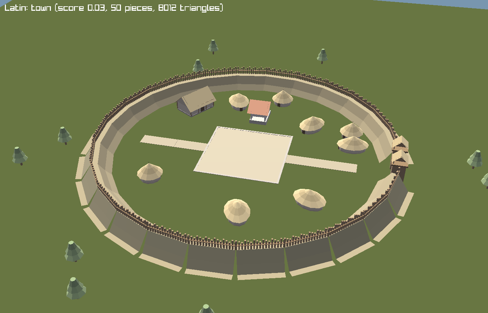
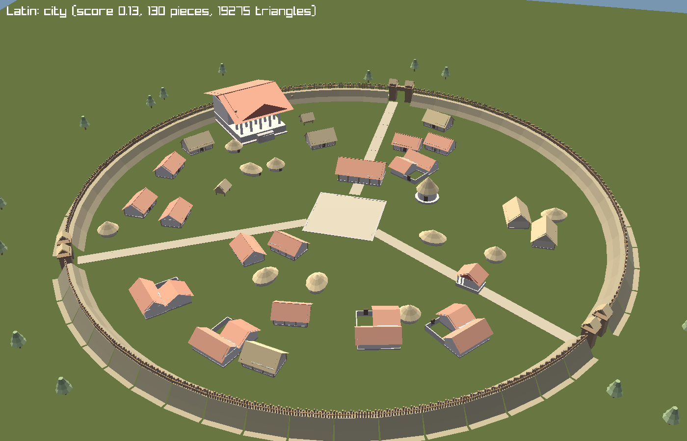
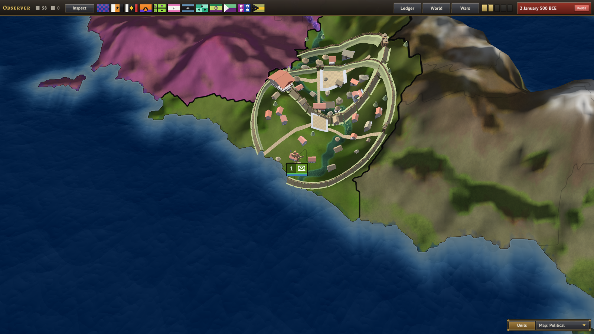
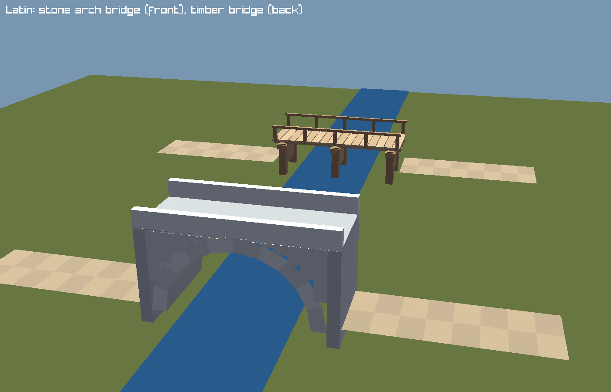

# Sites: procedural location models

Large locations get a 3D settlement built from kit pieces. First kit: `latin` (Rome = city tier; the town tier exists in the kit and shows in `--site-sheets`, but no site uses it now: Latium was removed because its model overlapped Rome).

## Pipeline

1. `tools/assets/models/site_<kit>.py` (uses `gear_lib.py`) writes `out/site_<piece>_<kit>.glb`. Metres, +Y up, facing +Z, all vertices on the root joint. Copy to `projects/World500BCE/game/gfx/models/`.
2. `common/sites/*_kit.txt` defines kits and tiers. `common/sites/*_sites.txt` lists sites (`name`, `location`, `weight`).
3. `SiteSystem` (Core/Sites): score = `Development.Urbanization(state) x weight`, rounded to 0.01. Kit = the kit whose `culture_groups` holds the state's dominant pop culture group. Tier = highest `min_score` reached. Layout is deterministic (seed = FNV hash of site key), baked into one `FigureModel`. Rebuilt monthly only if kit, tier, score step or `Figures.Version` changed.
4. `MapSites` (Game) draws baked models at `MetresToWorld = 0.05`, only when camera height <= `ShowBelow = 90`, not in globe mode, not on non-visible locations.

## Layer kinds (tier `layers`)

- `place`: one piece at fixed x, z, yaw.
- `ring`: wall segments plus gate pieces on a circle. Gate angles feed `street`.
- `street`: paths from center to each gate.
- `scatter`: weighted pieces, no overlap, count = `count + count_per_score x score`, between inner and outer radius, face center / random / radial.

Yaw 0 = +Z, turning towards +X. Footprint radius = max horizontal reach x 0.8. Terrain: pieces named in `SiteLayout.HugsGround` (`path`, `plaza`, `rampart`) follow the ground at every vertex, so the generator cuts them into 1-2 m cells. All other pieces follow it at their feet (first 1.2 m) and sink 0.12 m. Each placement gets a stable slight tint.

Fit: after layout, `SiteSystem.Fit` shrinks the whole site (down to 0.7) and shifts it (up to 4 steps) until 85% of the placements stand on the site's own location pixels; placements outside are dropped. If that fails, it may use land neighbors of the same state, down to scale 0.3 (Rome's location is only 44 pixels). Startup log shows pixel counts.

## Bridges

Kit key `bridge = { wood = <piece> stone = <piece> stone_year = Y stone_min_score = S }`. Pieces are 8 m long like `path`. After the fit, `SiteSystem.Bridge` checks every street (`path`) piece against `Map.RiverMap` (river pixel within 1 px of 5 sample points along the piece; 2 hits = wet). A run of consecutive wet pieces is one crossing, and its pieces become bridge pieces at the same place and heading.
- Stone: game year >= `stone_year` (negative = BCE), site score >= `stone_min_score` (development: state urbanization x site weight), and a crossing of at most 3 pieces (an arch cannot span wide water).
- Otherwise timber (a trestle crosses wide water). The sheet `site_<kit>_bridges.png` shows both.
- Latin: `stone_year = -300`, `stone_min_score = 0.15`. OPEN: design choices, not sourced; Rome's first stone-arched bridge was 179 BCE, the Pons Sublicius was timber. At 500 BCE Rome gets timber.
- Only street pieces cross rivers. Bridges are not instanced separately, they are part of the site's baked model. They do not follow the terrain between banks (the deck is level).

## Commands

Preview sheets (offscreen, no game load):
`dotnet run --project src/Burger.Game -c Release -- --game projects/World500BCE/game --site-sheets OUTDIR [--site-kit KEY] [--site-score S]`

In-game screenshot (`--lookat` takes `lon,lat` or a location key):
`dotnet run --project src/Burger.Game -c Release -- --game projects/World500BCE/game --observe --size 1600x900 --lookat land_04924 --zoom 12 --days 1 --screenshot out.png --frames 30 --log-dir DIR`

Startup log lists every site: `Site 'key': loc at map pixel x,y (state ...)`.

## Add a kit

1. Copy `site_latin.py`, change pieces, budgets, colors. Run it, copy glbs.
2. Add `common/sites/NN_<kit>_kit.txt` with `culture_groups` and tiers.
3. Run `--site-sheets`, view PNGs, tune.
4. Add sites, screenshot in game, copy PNGs to `docs/game/img/`.

## Add a site

Add entry to `01_sites.txt`: `key = { name = "X" location = land_NNNNN weight = W }`. Needs the location's state to have a kit for its culture group.

## OPEN

- Latin kit design (hut shapes, wall style, temple layout) is not sourced against archaeology. Unverified.
- Rome's own location is 44 pixels, so Rome uses neighbor locations of its state. A per-site territory list is not implemented.
- `ShowBelow`, `MetresToWorld` untuned. No instancing: one baked mesh per site.
- Globe mode shows no sites.

## Layouts that follow the land

Layer kinds beyond `place`, `ring`, `street` and `scatter`:

- `outline`: wall that follows the location's border. Per angle, radius = min(`radius`, edge reach - `margin`), smoothed. Gates (`gates`, `gate_angle`, `gate` piece) sit on the nearest wall piece.
- `terrace`: one piece on the best high ground within `inner`..`radius`, low slope, facing the center.
- `street` params: `meander` (degrees of turn per piece). Without a wall, uses its own `gates` and `gate_angle`.
- `scatter` param: `falloff` (above 1 packs pieces towards the center). Pieces stay inside the wall; layers starting beyond the wall may use any land.
- `place` spots outside the land slide towards the center.

Tiers with `outline` or `terrace` are built at scale 1 on the most open spot of the location (the neighbors of the same state too when the location is small), by `SiteSystem.MakeTerrain`. Other tiers still use `Fit`.

Rome: outline hill-town. Persian city: unwalled, palace terrace on the highest ground, winding roads. Persian town: small outline wall. Images: site-rome-outline.png, site-persian-city-ingame.png.

OPEN: Persian design is unsourced. No Persian bridge pieces. Persian mud-brick colors read too bright in game.
