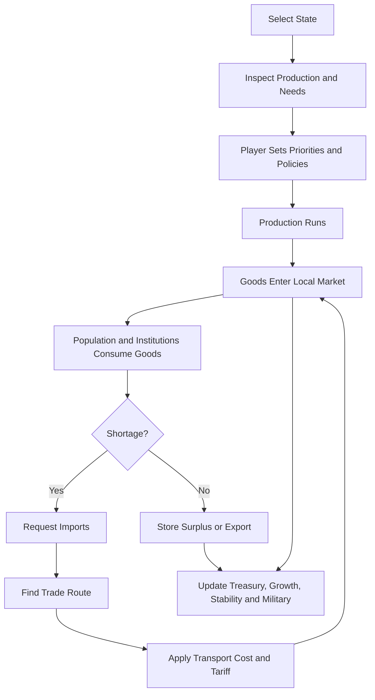

# Trade and Industry System

## Summary

Trade/Industry converts population labour, land, deposits, buildings, production methods, and equipment inputs into food, services, and goods, then moves the result through local markets and foreign trade. The current implementation uses state markets aggregated into the existing country commodity books, deterministic land/sea/caravan routes, capacity and transport costs, tariffs/customs, agreements, class-specific needs, recipe/workforce allocation, trade history, player policy/build/import/method controls, and AI import-versus-build planning. Era-gated modern factory recipes and buildings are included in the World500BCE timeline for later dates.

## How it plays

1. The player selects a state.

2. The state panel shows:

   - Population and available labour
   - Farms, mines, workshops, and production methods
   - Commodity supply and demand
   - Stockpiles and prices
   - Active imports and exports
   - Shortages and production bottlenecks

3. The player chooses actions:

   - Build or upgrade production buildings
   - Select production methods
   - Prioritize food, tools, weapons, or luxury production
   - Set import/export priorities
   - Establish trade agreements
   - Set tariffs
   - Create stockpile reserves
   - Ration scarce goods during crises

4. Production occurs:

```text
Population labour
        +
Land, deposits, buildings, technology
        ↓
Production methods
        ↓
Raw materials and processed goods
```

5. Population and institutions create demand:

```text
Population → food, salt, clothing, fuel
Army → food, weapons, horses, textiles
Construction → timber, stone, tools
Elite institutions → wine, luxury goods, precious materials
```

6. The local state market attempts to satisfy demand and retains bounded stockpiles.

7. If local supply is insufficient, state markets search for a permitted route to a surplus state.

8. Trade routes calculate:

```text
Origin price
+ transport cost
+ route risk
+ customs fees
+ tariff
= landed import price
```

9. The player receives feedback:

   - Food shortage
   - Rising prices
   - Idle workshops
   - Failed or capacity-limited imports
   - Surplus exports
   - Increased customs revenue
   - Population migration or unrest



## How it looks and sounds

### Visual style

The interface should feel like an economic instrument panel combined with a map ledger.

```text
BABYLON — ECONOMY
────────────────────────────────────
Food satisfaction       96%  Stable
Basic goods             84%  Mild shortage
Industrial inputs       71%  Tin constrained
Luxury access           42%  Elite demand unmet

COMMODITY       SUPPLY   DEMAND   STOCK   PRICE
Grain             120      100      28     1.0
Salt               12       14       2     1.4
Wool               18       10       6     0.9
Copper              3        6       0     2.1
Tin                 1        4       0     3.7
Bronze              2        3       1     1.8
Textiles            8       11       1     1.5
```

Map overlays:

- Green: food surplus
- Yellow: production bottleneck
- Red: shortage or famine risk
- Blue arrows: imports
- Gold arrows: exports
- Broken arrows: unsafe or blocked trade routes
- Purple: luxury trade
- Grey: unavailable technology or resource

### Animation and feedback

- Farms visibly harvest during production cycles.
- Mines show extraction activity.
- Workshops display active or idle status.
- Trade routes animate cargo movement.
- Stockpile bars fill or empty over time.
- Shortage icons pulse when supply falls below minimum demand.
- Tariff changes update the landed-price preview immediately.

### Sound

- Harvest: low-volume agricultural sound.
- Workshop: hammering, furnace, or loom activity.
- Market: crowd and merchant ambience.
- Trade route: cart, ship, or caravan cues.
- Shortage: restrained warning tone.
- Famine or military supply crisis: deeper alert with escalating intensity.

## Rules and numbers

These are proposed prototype values, not final balance values.

### Commodity categories

```text
Food
Basic goods
Raw materials
Industrial inputs
Intermediate goods
Military goods
Luxury goods
Currency and wealth
```

Gold, silver, currency, and enslaved people are not ordinary population-consumption commodities.

### Production activation

A production method is active only when:

```text
current_date >= start_date
technology >= required_technology
required_resource_exists = true
required_building_exists = true
```

Production output:

```text
output = base_output or (worker_count × method_base_output)
         × input_satisfaction

Only one method is active for each state/output: the player's explicit choice, or the newest available method when no choice is saved.
```

### Prototype population needs

Commodity quantities are abstract monthly units.

Per 1,000 population per month:

```text
staple_food       1.00
salt              0.05
basic_textiles    0.10
fuel              0.05 rural / 0.12 urban
luxury_goods      0.01 common / 0.08 noble
```

Army and institutions have separate demand profiles.

### Prototype production

Per 1,000 fully employed workers per month:

```text
cereal farming    1.20 grain
herding           0.30 animal products
                  0.20 wool/hides
fishing           0.70 fish
textile workshop  0.60 textiles
pottery workshop  0.50 pottery
bronze workshop   0.30 bronze
iron workshop     0.20 iron goods
```

These values should be balanced against population demand and regional fertility.

### Market order

Every monthly market cycle follows this order:

1. Calculate production.
2. Consume industrial inputs.
3. Add finished output to the state market.
4. Calculate population and institutional demand.
5. Consume from local supply.
6. Use stockpiles.
7. Request imports.
8. Apply transport costs and tariffs.
9. Apply imported supply.
10. Export remaining surplus.
11. Calculate prices and satisfaction.
12. Apply growth, unrest, tax, migration, and military effects.

### Stockpiles

Initial prototype limits:

```text
Food reserve target       3 months
Food maximum storage      6 months
Non-food reserve target   2 months
Non-food maximum storage  12 months
```

Food spoilage:

```text
normal storage             5% monthly
poor storage              10% monthly
preserved goods             2% monthly
```

### Satisfaction

```text
95–100%     fully satisfied
75–94%      mild shortage
50–74%      serious shortage
25–49%      severe shortage
0–24%       crisis
```

Effects:

- Food below 75%: reduced growth.
- Food below 50%: migration and unrest.
- Food below 25%: mortality and severe instability.
- Tools below 75%: lower agricultural and industrial output.
- Fuel below 75%: workshops lose efficiency.
- Weapons below 75%: army reinforcement slows.
- Luxury shortages primarily affect elites, prestige, and political loyalty.

### Price limits

```text
minimum price = 0.50 × base price
maximum price = 3.00 × base price
```

A basic price formula:

```text
price =
  base_price
  × scarcity_modifier
  × transport_modifier
  × route_risk_modifier
  × tariff_modifier
```

### Trade rules

Trade is attempted in this order:

```text
local state market
    ↓
domestic country market
    ↓
neighbouring country
    ↓
regional trade network
    ↓
long-distance trade network
```

Trade is blocked or reduced by:

- War
- Embargo
- Hostile relations
- Closed borders
- Insufficient route capacity
- Piracy or banditry
- Seasonal route closure
- Excessive transport costs
- Tariffs
- Customs failure
- Lack of currency or credit

### Tariffs

Prototype tariff range:

```text
0%       free trade
5–15%    normal customs duty
16–30%   protectionist tariff
31–50%   restrictive tariff
over 50% prohibited or smuggling-prone
```

Tariffs:

- Increase treasury revenue.
- Increase import prices.
- Reduce import volume.
- Protect local producers.
- Increase shortage risk.
- Increase smuggling if customs enforcement is weak.

### 500 BCE production chains

```text
Farmers → grain → population food

Herders → livestock, wool, hides → food and textiles

Copper + tin + charcoal → bronze → tools and weapons

Iron ore + charcoal → iron → tools and weapons

Wool/flax/silk → textiles

Clay + fuel → pottery

Sand + alkali + fuel → glass

Timber + tools → ships and construction
```

### Era evolution

Commodity identities remain stable, but production methods evolve.

```text
500 BCE:
  wood, charcoal, copper, tin, bronze, iron

Medieval:
  improved furnaces, water power, expanded textiles

Industrial:
  coal, steel, machinery, chemicals, rubber

Modern:
  oil, gas, electricity, aluminium, fertilizer

Contemporary:
  semiconductors, lithium, cobalt, graphite, rare earths
```

## Open questions

- World500BCE has state markets and route paths; the map renders recent transactions as land, sea, and caravan arrows. Clicking a route opens a route inspector, while blocked sea routes use a red overlay.
- Recipe methods are date-gated, input-sensitive, can require a known technology, and can be explicitly selected per state/output by players or commands. The service sector now has demand, buildings, recipes, and workforce allocation; a richer institutional model remains future work.
- World500BCE now enables the existing `production` feature: AI and player equipment lines consume the era-appropriate commodity inputs, while modern factory buildings and methods remain date-gated for later dates.
- Blockades have deterministic script/command hooks (`TradeNetworkSystem.SetBlockade`, `blockade_TAG`, and `set_trade_blockade`) and hostile naval fleets outside either trading coast block sea routes when the navy feature is enabled.
- Does the player directly assign labour, or do pops choose jobs automatically?
- Should grain, fish, and meat be separate needs or substitutes within one food category?
- Which goods are local-only and which can be traded internationally?
- Should ships be commodities, equipment, or route capacity?
- Should slavery affect production through labour rules rather than commodity ownership?
- Are tariffs controlled nationally, by state governors, or by trade companies?
- Should food be consumed monthly or daily?
- How much should historical accuracy override gameplay simplicity?
- Should luxury goods be individual commodities or grouped into regional luxury categories?
- Should prices be visible to the player or mostly abstracted into shortage indicators?

## Checklist

- [ ] Design approved
- [x] Prototype
- [x] Define 500 BCE commodity data
- [x] Define 500 BCE production recipes and workforce allocation
- [x] Define population needs
- [x] Add local state markets
- [x] Add stockpiles and shortages
- [x] Add domestic/foreign routed trade
- [x] Add country-level foreign exchange
- [x] Add foreign trade routes, distance, capacity, transport cost, and blockade hooks
- [x] Add tariffs, customs, agreements, and player trade policy
- [x] Add date-gated later-era recipe definitions
- [x] Add technology-key requirements
- [x] Add player-selectable production methods
- [x] Enable equipment production lines and commodity inputs
- [x] Enable era-gated modern factory recipes/buildings
- [x] Add service-sector production and class-specific service needs
- [x] Add AI productive-capacity investment
- [x] Add AI budgets and import-versus-build decisions
- [x] Add bounded trade history and save/load section
- [x] Add multiplayer trade commands and economic checksum coverage
- [x] Add economy UI (Ledger: Global Trade and Industry tabs)
- [x] Add country drill-down, recent route history, and player controls to the ledger
- [x] Render recent trade routes on the map
- [x] Add selectable route inspection and blockade state to the map
- [x] Complete long-run, multiplayer, and balance stability certification

Validation evidence (18 October 2026): `trade-test World500BCE` passed; `validate World500BCE --days 90 --reload-at 30` passed; `validate World500BCE --days 365 --reload-at 180` passed; and `mp-test World500BCE --days 0 --seed 7` passed with only its deliberate injected resync.

## References

### Project references

- [`CommoditySystem.cs`](/mnt/Data/Projects/WrektBurgerEngine/src/Burger.Core/Production/CommoditySystem.cs)
- [`TradeNetworkSystem.cs`](/mnt/Data/Projects/WrektBurgerEngine/src/Burger.Core/Production/TradeNetworkSystem.cs)
- [`ProductionSystem.cs`](/mnt/Data/Projects/WrektBurgerEngine/src/Burger.Core/Production/ProductionSystem.cs)
- [`GameCommand.cs`](/mnt/Data/Projects/WrektBurgerEngine/src/Burger.Core/Multiplayer/GameCommand.cs)
- [`PopulationSystem.cs`](/mnt/Data/Projects/WrektBurgerEngine/src/Burger.Core/Population/PopulationSystem.cs)
- [`Game.cs`](/mnt/Data/Projects/WrektBurgerEngine/src/Burger.Core/Game.cs)
- [`World500BCE features.txt`](/mnt/Data/Projects/WrektBurgerEngine/projects/World500BCE/game/features.txt)
- [`MODDING.md`](/mnt/Data/Projects/WrektBurgerEngine/docs/game/MODDING.md)
- [`WORLD500BCE.md`](/mnt/Data/Projects/WrektBurgerEngine/docs/game/WORLD500BCE.md)

### Historical research

- [Encyclopaedia Iranica: Achaemenid commerce](https://www.iranicaonline.org/articles/commerce-ii/)
- [Metropolitan Museum: Greek colonization and trade](https://www.metmuseum.org/ja/essays/ancient-greek-colonization-and-trade-and-their-influence-on-greek-art)
- [Ancient jades and Southeast Asian exchange](https://pmc.ncbi.nlm.nih.gov/articles/PMC2148369/)
- [Metropolitan Museum: The World between Empires](https://resources.metmuseum.org/resources/metpublications/pdf/The_World_between_Empires_Art_and_Identity_in_the_Ancient_Middle_East.pdf)
- [Cambridge: Bronze Age interaction and collapse](https://www.cambridge.org/core/journals/proceedings-of-the-prehistoric-society/article/connected-histories-the-dynamics-of-bronze-age-interaction-and-trade-15001100-bc/46BCCABC4C8D05B5D5846D891D51F92D)
- [IEA: Global Critical Minerals Outlook](https://www.iea.org/reports/global-critical-minerals-outlook-2024/market-review)
